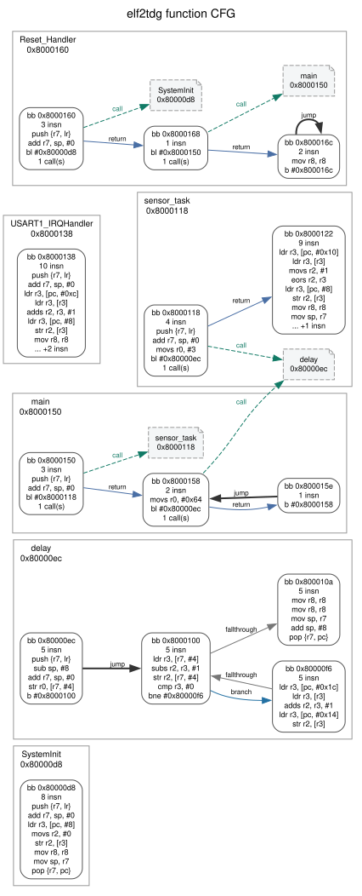

# Cortex-M0 ISR and timing example

[`main.c`](main.c) is a freestanding Cortex-M0 image with:

- a reset handler and a `main` loop;
- a small call chain (`Reset_Handler -> main -> sensor_task -> delay`);
- USART1 interrupt 37, wired to vector 53 in the vector table.

The ELF is linked with a tiny linker script and contains symbols, debug info,
and the Cortex-M vector table, so the analyzer can recover both the call graph
and the interrupt root.

## Build and analyze

```sh
make
# or, when the cargo registry is already populated:
make CARGO_FLAGS=--offline
```

Requirements: `arm-none-eabi-gcc`, `cargo`, and Graphviz `dot`.

## Artifacts

| File | Contents |
|---|---|
| [`artifacts/cortex-m0-isr.elf`](artifacts/cortex-m0-isr.elf) | linked Cortex-M0 ELF |
| [`artifacts/cfg-main.json`](artifacts/cfg-main.json) | lossless CFG JSON for `main` |
| [`artifacts/cfg-main.dot`](artifacts/cfg-main.dot) | Graphviz source for the `main` CFG |
| [`artifacts/cfg-main.svg`](artifacts/cfg-main.svg) | rendered `main` CFG |
| [`artifacts/cfg-main.mmd`](artifacts/cfg-main.mmd) | Mermaid source for the `main` CFG |
| [`artifacts/cfg-system.json`](artifacts/cfg-system.json) | multi-root system CFG JSON (main + reset + ISR) |
| [`artifacts/cfg-system.dot`](artifacts/cfg-system.dot) | Graphviz source for the system CFG |
| [`artifacts/cfg-system.svg`](artifacts/cfg-system.svg) | rendered system CFG including the USART1 ISR |
| [`artifacts/cfg-system.mmd`](artifacts/cfg-system.mmd) | Mermaid source for the system CFG |
| [`artifacts/elf-layout.mmd`](artifacts/elf-layout.mmd) | loader-backed ELF layout with colored segments and disassembly |

CFG output is documented in [`../../docs/cfg-format.md`](../../docs/cfg-format.md);
the loader view is documented in [`../../docs/elf-view.md`](../../docs/elf-view.md).

## Diagram



The analyzer reports:

- execution roots for `Reset_Handler`, `main`, and `USART1_IRQHandler`;
- the ISR root retains vector 53 and IRQ 37;
- direct call edges `Reset_Handler -> SystemInit`, `Reset_Handler -> main`,
  `main -> sensor_task`, `main -> delay`, and `sensor_task -> delay`;
- `main` and `Reset_Handler` classified `noreturn` from their CFGs: the reset
  handler's fallback loop after `main()` is pruned as unreachable, while
  `main`'s own infinite loop remains;
- Cortex-M0 bounded cycle estimates and wall-clock nanoseconds at 48 MHz.

For example, the JSON contains a static block sum of 16–20 cycles for
`USART1_IRQHandler`, i.e. about 333–417 ns at 48 MHz. That is a **static block
sum**, not a path time or a WCET bound; loops and pipeline effects are not
included.
