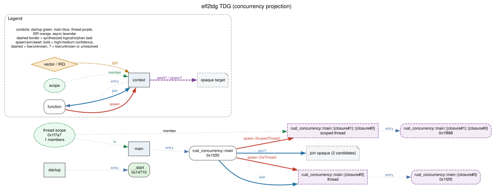

# Rust concurrency example

[`main.rs`](main.rs) is a small host Rust program with:

- one ordinary `std::thread::spawn` worker followed by `JoinHandle::join`;
- one `std::thread::scope` region with `Scope::spawn` and `ScopedJoinHandle::join`.

Both wait for their workers, so the generated TDG has explicit `spawn`, `join`,
and scope-member relations.

## Build and analyze

The default build uses the recommended analysis profile from
[`Cargo.toml`](Cargo.toml): `opt-level=1`, full DWARF, ThinLTO and no symbol
stripping.

```sh
make
```

Or with an offline cargo cache:

```sh
make CARGO_FLAGS=--offline
```

The build needs the host `rustc`, `cargo`, and Graphviz `dot`. See
[`../../docs/analysis-profile.md`](../../docs/analysis-profile.md) for why
`-O1` + `debug = true` is the recommended starting point for static analysis.

## Artifacts

| File | Contents |
|---|---|
| [`artifacts/rust-concurrency-analysis.elf`](artifacts/rust-concurrency-analysis.elf) | ELF built with the recommended `analysis` profile (`-O1`, full DWARF, ThinLTO) |
| [`artifacts/tdg-analysis.json`](artifacts/tdg-analysis.json) | full TDG JSON for the `analysis` profile |
| [`artifacts/tdg-analysis-concurrency.dot`](artifacts/tdg-analysis-concurrency.dot) | Graphviz source, concurrency projection |
| [`artifacts/tdg-analysis-concurrency.svg`](artifacts/tdg-analysis-concurrency.svg) | rendered concurrency TDG with legend |
| [`artifacts/tdg-analysis-concurrency-compact.svg`](artifacts/tdg-analysis-concurrency-compact.svg) | same diagram without the embedded legend |
| [`artifacts/tdg-analysis-concurrency.mmd`](artifacts/tdg-analysis-concurrency.mmd) | Mermaid source, concurrency projection |
| [`artifacts/cfg-analysis-main.json`](artifacts/cfg-analysis-main.json) | lossless CFG JSON for `rust_concurrency::main`, including `inline_frames` |
| [`artifacts/cfg-analysis-main.svg`](artifacts/cfg-analysis-main.svg) | function CFG diagram for the analysis build |
| [`artifacts/cfg-analysis-main.mmd`](artifacts/cfg-analysis-main.mmd) | Mermaid source for the analysis CFG |
| [`artifacts/elf-layout-analysis.mmd`](artifacts/elf-layout-analysis.mmd) | loader-backed ELF layout for the analysis build |

A browser walkthrough with the diagram and the complete legend is
[`../tdg-example.html`](../tdg-example.html). CFG output is documented in
[`../../docs/cfg-format.md`](../../docs/cfg-format.md); the loader view is
documented in [`../../docs/elf-view.md`](../../docs/elf-view.md).

## Recommended `analysis` profile



The analysis build keeps `-O1` machine code and full DWARF. It still removes
wrapper/stack noise, while `inline_frames` in
[`cfg-analysis-main.json`](artifacts/cfg-analysis-main.json) retain the concrete
ranges of inlined `thread::spawn`, `Scope::spawn` and their nested
implementation layers. Spawn/join/scope semantics are reconstructed from those
ranges rather than from a call instruction that no longer exists. The
integration test in `crates/elf2tdg/tests/inline_dwarf.rs` applies the same
mechanism to `Mutex::lock`.

The analyzer recovers four contexts from this build:

- `startup` and `main`;
- a `thread` context whose entry is
  `rust_concurrency::main::{closure#0}`;
- a `scoped-thread` context whose entry is
  `rust_concurrency::main::{closure#1}::{closure#0}`.

Both spawn sites (`thread::spawn` and `Scope::spawn`) are recovered from DWARF
inline records, even though they were inlined into `main`. Their entries are
represented by logical `task-entry` functions/contexts marked
`ext["elf2tdg.logical_task"]`. The first join resolves to the thread context.
The second join follows both spawns in the same physical function and has two
possible targets, so the TDG reports an **opaque join with two candidates**
instead of guessing.

See [`../../docs/analysis-profile.md`](../../docs/analysis-profile.md) for the
profile, caveats and the `Mutex::lock` inline-frame example.

## What to look for in the diagram

| Visual | Meaning |
|---|---|
| box labelled `main`/`thread`/`scoped-thread`/`startup` | execution context |
| rounded white box | function, with its address and static block-sum cycles when timed |
| green dashed ellipse | structured scope |
| red bold arrow | `spawn` |
| blue bold arrow | `join` |
| green dotted arrow | scope `in`/`member` relation |
| dotted blue arrow | context `entry` function |
| gray note with `?` | unresolved target with candidate list in JSON |
| bold vs dashed red/blue | high/medium vs low/unknown confidence |
| `?` suffix | low/unknown confidence or unresolved target |

The full legend is rendered into every `--legend` diagram. See
[`../../docs/tdg-legend.md`](../../docs/tdg-legend.md) for the complete schema
legend.

## Inspect the result directly

```sh
jq '.contexts, (.edges[] | select(.kind == "spawn" or .kind == "join"))' artifacts/tdg-analysis.json
jq '.scopes' artifacts/tdg-analysis.json
jq '.functions[0].inline_frames[] | select(.name | test("Mutex|spawn"))' \
    artifacts/cfg-analysis-main.json
jq '.diagnostics | group_by(.code) | map({code: .[0].code, count: length})' \
    artifacts/tdg-analysis.json
```

The JSON is the canonical output; the diagrams are projections of the same
graph and deliberately omit ordinary call edges in concurrency mode.
