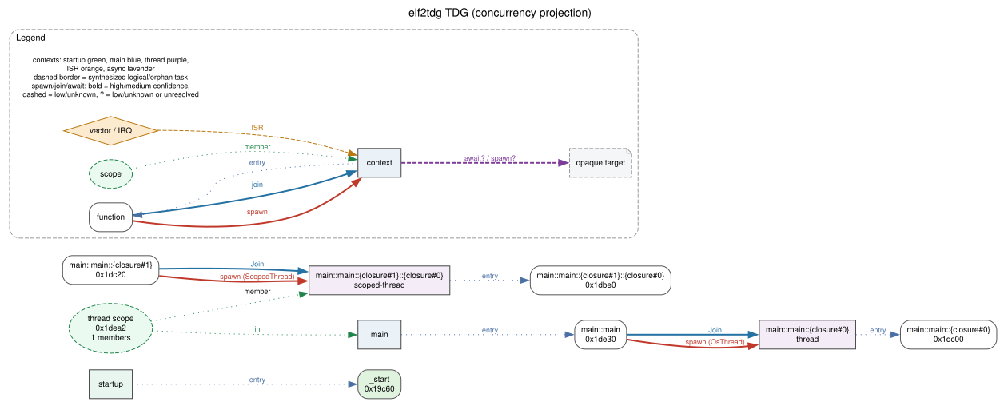
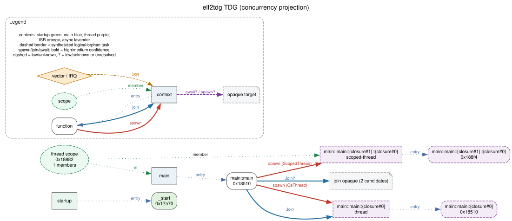

# Rust concurrency example

[`main.rs`](main.rs) is a small host Rust program with:

- one ordinary `std::thread::spawn` worker followed by `JoinHandle::join`;
- one `std::thread::scope` region with `Scope::spawn` and `ScopedJoinHandle::join`.

Both wait for their workers, so the generated TDG has explicit `spawn`, `join`,
and scope-member relations.

## Build and analyze

From this directory:

```sh
make
```

Or with an offline cargo cache:

```sh
make CARGO_FLAGS=--offline
```

The build needs the host `rustc`, `cargo`, and Graphviz `dot`.

## Artifacts

| File | Contents |
|---|---|
| [`artifacts/rust-concurrency-o0.elf`](artifacts/rust-concurrency-o0.elf) | unoptimized ELF used for the first analysis |
| [`artifacts/rust-concurrency-o2.elf`](artifacts/rust-concurrency-o2.elf) | optimized ELF with inlined spawn calls |
| [`artifacts/tdg-o0.json`](artifacts/tdg-o0.json) | full TDG JSON for `-O0` |
| [`artifacts/tdg-o0-concurrency.dot`](artifacts/tdg-o0-concurrency.dot) | Graphviz source, concurrency projection |
| [`artifacts/tdg-o0-concurrency.svg`](artifacts/tdg-o0-concurrency.svg) | rendered concurrency TDG with legend |
| [`artifacts/tdg-o0-concurrency-compact.svg`](artifacts/tdg-o0-concurrency-compact.svg) | same diagram without the embedded legend |
| [`artifacts/tdg-o0-concurrency.mmd`](artifacts/tdg-o0-concurrency.mmd) | Mermaid source, concurrency projection |
| [`artifacts/cfg-o0-main.json`](artifacts/cfg-o0-main.json) | lossless CFG JSON for `main::main` at `-O0` |
| [`artifacts/cfg-o0-main.svg`](artifacts/cfg-o0-main.svg) | function CFG diagram for `-O0` |
| [`artifacts/tdg-o2.json`](artifacts/tdg-o2.json) | full TDG JSON for `-O2` |
| [`artifacts/tdg-o2-concurrency.svg`](artifacts/tdg-o2-concurrency.svg) | optimized-build TDG with legend |
| [`artifacts/tdg-o2-concurrency-compact.svg`](artifacts/tdg-o2-concurrency-compact.svg) | same diagram without the embedded legend |
| [`artifacts/tdg-o2-concurrency.mmd`](artifacts/tdg-o2-concurrency.mmd) | Mermaid source for the optimized build |
| [`artifacts/cfg-o2-main.json`](artifacts/cfg-o2-main.json) | lossless CFG JSON for `main::main` at `-O2` |
| [`artifacts/cfg-o2-main.svg`](artifacts/cfg-o2-main.svg) | function CFG diagram for `-O2` |

A browser walkthrough with both diagrams and the complete legend is
[`../tdg-example.html`](../tdg-example.html). CFG output is documented in
[`../../docs/cfg-format.md`](../../docs/cfg-format.md).

## The two diagrams

### `-O0`: concrete closure functions



The analyzer recovers four contexts:

- `startup` and `main`;
- a `thread` context whose entry is `main::{closure#0}`;
- a `scoped-thread` context whose entry is
  `main::{closure#1}::{closure#0}`.

Both spawn sites are resolved (`thread::spawn` and `Scope::spawn`), both joins
point at their contexts, and the `rust-thread-scope` scope owns the scoped
spawn. Edges are solid because they are high-confidence symbol/patch evidence.

### `-O2`: DWARF inline recovery



The spawn calls are inlined into `main`, so there is no direct call edge to the
`thread::spawn` or `Scope::spawn` wrappers. M2 recovers both call sites from
DWARF `DW_TAG_inlined_subroutine` records. Their entries are represented by
logical `task-entry` functions/contexts marked
`ext["elf2tdg.logical_task"]`.

The first join resolves to the thread context. The second join follows both
spawns in the same physical function and has two possible targets, so the TDG
reports an **opaque join with two candidates** instead of guessing. This is why
the O2 diagram contains a `join opaque` node.

## What to look for in the diagram

| Visual | Meaning |
|---|---|
| box labelled `main`/`thread`/`scoped-thread`/`startup` | execution context |
| rounded white box | function, with its address and static block-sum cycles when timed |
| green dashed ellipse | structured scope |
| red bold arrow | `spawn` |
| blue bold arrow | `join` |
| green dotted arrow | scope `in`/`member` relation |
| dotted blue arrow | context `entry` function |
| gray note with `?` | unresolved target with candidate list in JSON |
| bold vs dashed red/blue | high/medium vs low/unknown confidence |
| `?` suffix | low/unknown confidence or unresolved target |

The full legend is rendered into every `--legend` diagram. See
[`../../docs/tdg-legend.md`](../../docs/tdg-legend.md) for the complete schema
legend.

## Inspect the result directly

```sh
jq '.contexts, (.edges[] | select(.kind == "spawn" or .kind == "join"))' artifacts/tdg-o0.json
jq '.scopes' artifacts/tdg-o0.json
jq '.diagnostics | group_by(.code) | map({code: .[0].code, count: length})' artifacts/tdg-o2.json
```

The JSON is the canonical output; the diagrams are projections of the same
graph and deliberately omit ordinary call edges in concurrency mode.
